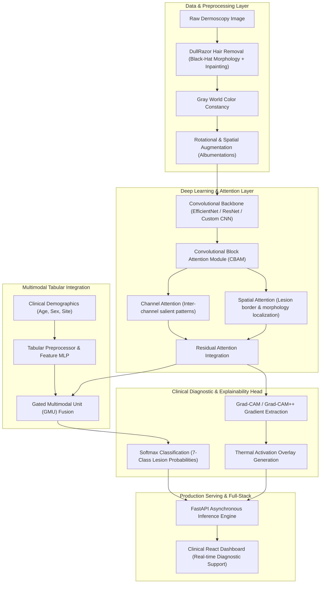

# DermaAI: System Architecture Blueprint

This document details the complete end-to-end software and machine learning architecture of the DermaAI system.

---

## 🏛️ High-Level System Architecture

---

## 🧩 Architectural Subsystems

### 1. Data & Preprocessing Subsystem
- **DullRazor Algorithm**: Uses a 9x9 rectangular structuring element to compute the morphological black-hat transform, isolating occluding dark hairs from lighter skin backgrounds. A threshold filter isolates hair masks, which are smoothly reconstructed using Telea's Fast Marching inpainting.
- **Color Constancy**: Uses the Gray World hypothesis to neutralize illumination differences resulting from different dermatoscope models and ambient room lighting.

### 2. Deep Learning & Attention Backbone
- **Modular Baseline CNN**: Built with 4 progressive convolutional stages, residual skip connections, spatial dropout, and batch normalization.
- **Transfer Learning Backbones**: Pre-trained on ImageNet with top classifier heads tailored for 7-class dermatological diagnosis.
- **Convolutional Block Attention Module (CBAM)**: Exploits channel attention (via dual average and max pooling into shared dense bottlenecks) and spatial attention (via 7x7 receptive field convolution) to refine feature representations before classification.

### 3. Explainable AI (XAI) Engine
- Computes first- and second-order gradients of the top predicted class activation score with respect to the final convolutional feature maps.
- Produces normalized thermal activation heatmaps highlighting the exact lesion characteristics driving the diagnosis.

### 4. Serving & Presentation Layer
- **FastAPI Backend**: Provides asynchronous image streaming, sub-second latency, and automatic OpenAPI schema validation.
- **React Dashboard**: Provides interactive lesion image upload, clinical demographic inputs, real-time probability charts, and interactive Grad-CAM heatmap toggles.
