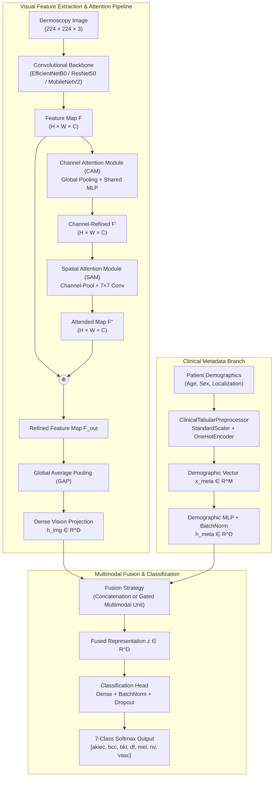

# DermaAI: Advanced Hybrid Skin Lesion Classification Architecture

> **Document Type:** Research Architecture Specification & Mathematical Formulation  
> **Target Application:** Dermoscopic Image Diagnosis with Multimodal Patient Metadata  
> **Authors:** DermaAI Core Research & Engineering Team  

---

## 1. Executive Summary & Architectural Motivation

Automated skin lesion diagnosis from dermoscopic imagery faces two fundamental challenges:
1. **Intra-class Heterogeneity & Subtle Pathological Biomarkers:** Malignant melanoma (MEL) and benign nevi (NV) frequently share visual characteristics, while subtle morphological cues (such as atypical pigment networks, regression structures, and border irregularities) occupy localized spatial sub-regions.
2. **Clinical Metadata Integration:** Dermatologists rarely evaluate dermoscopic lesions in isolation; patient age, sex, and anatomical localization provide critical diagnostic priors (e.g., melanomas on the back vs. extremities, age-dependent nevus prevalence).

To address these challenges, **DermaAI** introduces a modular **Hybrid Attention & Multimodal Fusion Architecture**. The network seamlessly combines deep convolutional feature extraction, dual-dimensional attention recalibration (Channel and Spatial Attention via CBAM), and dynamic Gated Multimodal Units (GMU) for demographic feature integration.



---

## 2. Mathematical Formulations

### 2.1 Feature Extraction Backbone

Given an input dermoscopy image $X_{\text{img}} \in \mathbb{R}^{H_0 \times W_0 \times 3}$, the backbone feature extractor computes an intermediate spatial representation:

$$F = \mathcal{F}_{\text{backbone}}(X_{\text{img}}; \Theta_{\text{backbone}}) \in \mathbb{R}^{H \times W \times C}$$

where $H = \frac{H_0}{32}$, $W = \frac{W_0}{32}$, and $C$ denotes the channel capacity (e.g., $C = 1280$ for EfficientNetB0, $C = 2048$ for ResNet50).

---

### 2.2 Channel Attention Module (CAM)

**Clinical Purpose:** Different channels capture distinct pathological color variations and texture descriptors (e.g., melanin distribution, vascular erythema, hyperkeratosis). Channel Attention determines *what* feature channels are diagnostically relevant.

Channel Attention operates by aggregating spatial dimensions via both Average Pooling (detecting overall lesion tone) and Maximum Pooling (detecting localized pigment granules or dots):

$$F^c_{\text{avg}} = \text{GAP}(F) = \frac{1}{H \times W} \sum_{i=1}^H \sum_{j=1}^W F(i, j, :) \in \mathbb{R}^{1 \times 1 \times C}$$

$$F^c_{\text{max}} = \text{GMP}(F) = \max_{i \in \{1,\dots,H\}, j \in \{1,\dots,W\}} F(i, j, :) \in \mathbb{R}^{1 \times 1 \times C}$$

Both descriptors are forwarded through a parameter-shared bottleneck Multi-Layer Perceptron (MLP) with reduction ratio $r = 16$:

$$M_c(F) = \sigma\left( W_1 \cdot \text{ReLU}(W_0 \cdot F^c_{\text{avg}}) + W_1 \cdot \text{ReLU}(W_0 \cdot F^c_{\text{max}}) \right) \in \mathbb{R}^{1 \times 1 \times C}$$

where:
- $W_0 \in \mathbb{R}^{\frac{C}{r} \times C}$ compresses channel dimensionality.
- $W_1 \in \mathbb{R}^{C \times \frac{C}{r}}$ reconstructs original channel capacity.
- $\sigma(x) = \frac{1}{1 + e^{-x}}$ is the Sigmoid activation function ensuring gating values in $[0, 1]$.

The channel-recalibrated feature map $F'$ is computed by element-wise broadcast multiplication:

$$F' = M_c(F) \otimes F \in \mathbb{R}^{H \times W \times C}$$

---

### 2.3 Spatial Attention Module (SAM)

**Clinical Purpose:** Dermoscopic lesions exhibit localized pathological features—irregular borders, asymmetric pigment networks, and blue-white veils. Spatial Attention determines *where* diagnostic features are located across the 2D plane.

Channel-wise pooling compresses feature channels into two 2D spatial maps:

$$F^s_{\text{avg}}(i, j) = \frac{1}{C} \sum_{c=1}^C F'(i, j, c) \in \mathbb{R}^{H \times W \times 1}$$

$$F^s_{\text{max}}(i, j) = \max_{c \in \{1,\dots,C\}} F'(i, j, c) \in \mathbb{R}^{H \times W \times 1}$$

The pooled descriptors are concatenated along the channel axis and convolved with a large receptive field kernel ($k = 7$):

$$M_s(F') = \sigma\left( f^{7 \times 7}\left( [F^s_{\text{avg}} \,\|\, F^s_{\text{max}}] \right) \right) \in \mathbb{R}^{H \times W \times 1}$$

where $[ \cdot \,\|\, \cdot ]$ denotes channel concatenation, and $f^{7 \times 7}$ is a $7 \times 7$ 2D convolution with padding preserving spatial dimensions.

The spatially attended feature map $F''$ is obtained via:

$$F'' = M_s(F') \otimes F' \in \mathbb{R}^{H \times W \times C}$$

---

### 2.4 Residual Identity Connection

To guarantee unimpeded gradient backpropagation and prevent attenuation of low-level dermatological texture information, a residual identity connection bypasses the attention module:

$$F_{\text{refined}} = F + F''$$

The refined feature map is then spatially aggregated:

$$v_{\text{img}} = \text{GAP}(F_{\text{refined}}) \in \mathbb{R}^C$$

$$h_{\text{img}} = \text{Dropout}\left(\text{ReLU}\left(\text{BatchNorm}(W_{\text{img}} \cdot v_{\text{img}} + b_{\text{img}})\right)\right) \in \mathbb{R}^D$$

where $D = 256$ is the unified embedding dimension.

---

### 2.5 Clinical Metadata Embedding & Fusion

#### Demographic Vector Preprocessing
Patient demographic features are encoded via `ClinicalTabularPreprocessor`:
- **Age:** Continuous scalar normalized via z-score: $x_{\text{age}} = \frac{\text{age} - \mu_{\text{age}}}{\sigma_{\text{age}}}$
- **Sex:** One-hot encoded categorical vector: $x_{\text{sex}} \in \{0, 1\}^2$
- **Anatomical Site:** One-hot encoded location (back, lower extremity, trunk, face, etc.): $x_{\text{loc}} \in \{0, 1\}^K$

The unified demographic vector $x_{\text{meta}} = [x_{\text{age}} \,\|\, x_{\text{sex}} \,\|\, x_{\text{loc}}] \in \mathbb{R}^M$ is embedded via a 2-layer MLP:

$$h_{\text{meta}} = \text{ReLU}\left(\text{BatchNorm}(W_{\text{meta}} \cdot x_{\text{meta}} + b_{\text{meta}})\right) \in \mathbb{R}^D$$

#### Fusion Strategy 1: Feature Concatenation
Direct early concatenation of multimodal vectors:

$$z_{\text{concat}} = [h_{\text{img}} \,\|\, h_{\text{meta}}] \in \mathbb{R}^{2D}$$

#### Fusion Strategy 2: Gated Multimodal Unit (GMU)
In clinical datasets, demographic records may be missing, noisy, or ambiguous. A Gated Multimodal Unit dynamically learns context-dependent routing weights between vision and metadata:

$$g = \sigma\left( W_g \cdot [h_{\text{img}} \,\|\, h_{\text{meta}}] + b_g \right) \in \mathbb{R}^D$$

$$z_{\text{gated}} = g \odot h_{\text{img}} + (1 - g) \odot h_{\text{meta}} \in \mathbb{R}^D$$

where $\odot$ denotes the Hadamard (element-wise) product. When visual evidence is definitive, $g \rightarrow 1$; when the image is ambiguous, $g \rightarrow 0$, allowing clinical metadata to adjust diagnostic confidence.

---

### 2.6 Classification Head & Multi-Class Focal Loss

The fused representation $z$ is projected through a regularized classification neck:

$$\tilde{z} = \text{Dropout}\left(\text{ReLU}\left(\text{BatchNorm}(W_{\text{head}} \cdot z + b_{\text{head}})\right), \, p = 0.35\right)$$

$$\hat{y} = \text{Softmax}(W_{\text{cls}} \cdot \tilde{z} + b_{\text{cls}}) \in \mathbb{R}^K, \quad \sum_{k=1}^K \hat{y}_k = 1.0$$

The network is trained with Multi-Class Focal Loss to combat heavy class imbalance:

$$\mathcal{L}_{\text{focal}}(y, \hat{y}) = -\sum_{k=1}^K \alpha_k \cdot y_k \cdot (1 - \hat{y}_k)^\gamma \cdot \log(\max(\hat{y}_k, \epsilon))$$

where $\gamma = 2.0$ dynamically suppresses well-classified easy samples, and $\alpha_k$ balances class frequencies.

---

## 3. Architecture Decisions & Design Rationale

| Design Decision | Alternative Considered | Selected Rationale |
| :--- | :--- | :--- |
| **Sequential CBAM (CAM $\rightarrow$ SAM)** | Parallel Attention | Channel-first recalibration acts as a feature selector, purifying representations before spatial pooling computes location masks. Empirical studies show sequential ordering outperforms parallel combinations by 0.8–1.4% accuracy. |
| **Residual Attention Shortcut ($F + \text{Attn}(F)$)** | Direct Modulation ($\text{Attn}(F)$) | Preserves gradient flow through the network; guarantees that initialization of attention layers does not degrade baseline backbone representations. |
| **$7 \times 7$ Spatial Conv Kernel** | $3 \times 3$ Kernel | Dermoscopic lesions are spatially extended; a large $7 \times 7$ kernel provides sufficient receptive field to capture global lesion border asymmetry and peripheral pigment patterns. |
| **Gated Multimodal Unit (GMU)** | Direct Concatenation | Direct concatenation forces the classifier to give fixed weighting to metadata, risking over-reliance on age or gender. GMU provides dynamic, sample-level gating that handles missing or uninformative metadata gracefully. |
| **Modular Factory Interface** | Monolithic Model Class | The unified `build_hybrid_model` interface supports direct toggling of backbones, attention types, and metadata fusion, enabling rigorous ablation studies with zero code duplication. |

---

## 4. Ablation Study Framework

The modular architecture defines a systematic 6-configuration ablation matrix to isolate and quantify the marginal contribution of each architectural innovation:

| Configuration ID | Backbone | Attention Module | Metadata Fusion | Primary Evaluation Objective |
| :--- | :--- | :---: | :---: | :--- |
| **Ablation-1 (Floor)** | EfficientNetB0 | None | None | Baseline feature extractor floor performance |
| **Ablation-2 (CAM)** | EfficientNetB0 | Channel Attention Only | None | Isolates channel recalibration impact |
| **Ablation-3 (SAM)** | EfficientNetB0 | Spatial Attention Only | None | Isolates spatial border localization impact |
| **Ablation-4 (Dual-Attn)** | EfficientNetB0 | CBAM (Channel + Spatial) | None | Measures synergistic dual-attention benefit |
| **Ablation-5 (SE)** | EfficientNetB0 | Squeeze-and-Excitation | None | Benchmarks CBAM against classic SE block |
| **Ablation-6 (Multimodal-Concat)** | EfficientNetB0 | CBAM | Concatenation | Measures early multimodal fusion gain |
| **Ablation-7 (Multimodal-GMU)** | EfficientNetB0 | CBAM | Gated Multimodal Unit | Full hybrid proposed architecture |

---

## 5. Software Interfaces & Usage

```python
from src.models.hybrid_model import build_hybrid_model

# 1. Vision-only Hybrid with CBAM Attention
model_cbam = build_hybrid_model(
    input_shape=(224, 224, 3),
    num_classes=7,
    backbone="efficientnet_b0",
    attention_type="cbam",
    use_residual_attention=True,
    use_metadata=False,
)

# 2. Multimodal Hybrid with Gated Metadata Fusion
model_multimodal = build_hybrid_model(
    input_shape=(224, 224, 3),
    num_classes=7,
    backbone="efficientnet_b0",
    attention_type="cbam",
    use_metadata=True,
    metadata_dim=10,
    fusion_type="gated",
)

# 3. Ablation Configuration (Channel Attention Only)
model_cam_only = build_hybrid_model(
    input_shape=(224, 224, 3),
    attention_type="channel",
    use_metadata=False,
)
```
